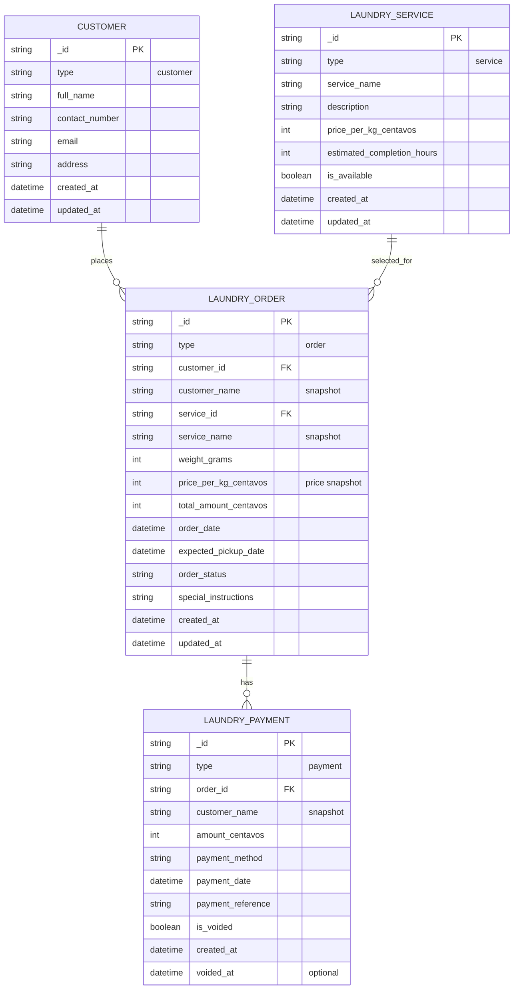

# Entity Relationship Diagram

The application stores these entities as JSON documents in one CouchDB database. Each document is identified by CouchDB's `_id` and distinguished by its `type` value. The relationships below are logical references; CouchDB does not enforce foreign keys.

## Relationship and Storage Notes

- A customer can have zero or more orders. Each order records one `customer_id` and the customer's name at order creation.
- A laundry service can be used by zero or more orders. Each order records one `service_id`, the service name, and the per-kilogram price at order creation. Referenced services are made unavailable instead of deleted.
- An order can have zero or more payments. Each payment records one `order_id`; its `customer_name` is a snapshot copied from that order, not a separate customer reference.
- Customers and services referenced by order history are retained. The app blocks deletion of those customers and deactivates those services.
- `_rev` is CouchDB-managed document revision metadata and is omitted from the domain attributes above. `payment_status` and remaining balance are calculated from an order and its non-voided payments; they are not stored as fields.
- Money is stored as integer centavos and laundry weight as integer grams. Readers also accept legacy fields (`price_per_kg`, `total_amount`, `amount_paid`, and `laundry_weight`) and convert them to the current units.

## Enumerated Values

- `order_status`: `Pending`, `Washing`, `Drying`, `Folding`, `Ready for Pickup`, `Claimed`, `Cancelled`
- `payment_method`: `Cash`, `GCash`, `Maya`, `Bank Transfer`
